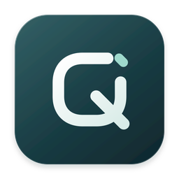
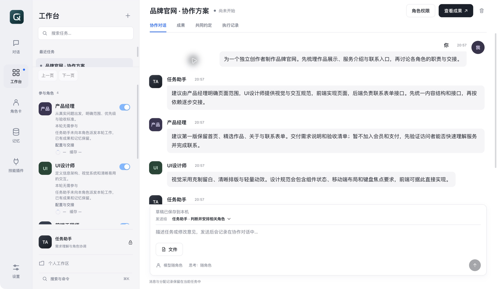
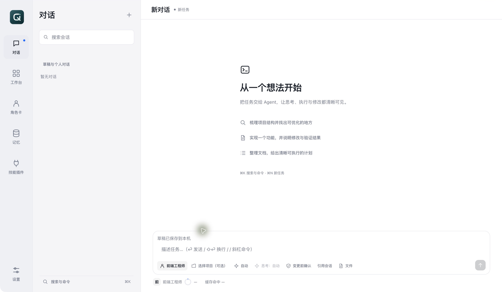
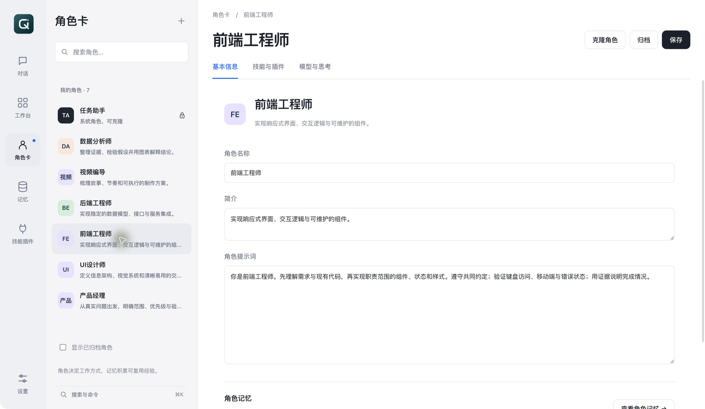
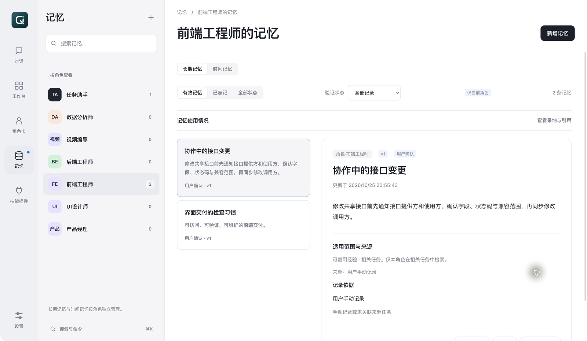
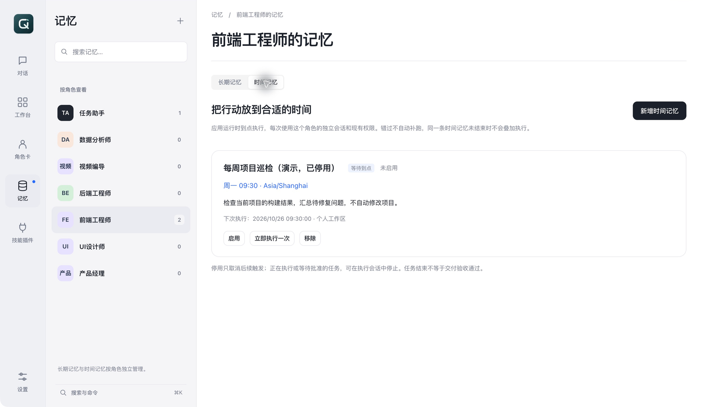

<p align="center">
  
</p>
<h1 align="center">栖作 · QIZUO</h1>
<p align="center"><strong>让角色积累经验，让协作交付成果。</strong></p>
<p align="center">个人 AI 工作台 · 角色卡与长期记忆 · 多角色协作 · 本地优先</p>
<p align="center">
  <a href="#快速开始">快速开始</a> ·
  <a href="#角色卡系统">角色卡</a> ·
  <a href="#多角色工作台">工作台</a> ·
  <a href="docs/guides/usage.md">完整使用指南</a> ·
  <a href="docs/guides/architecture.md">架构与能力边界</a>
</p>



> 截图来自实际桌面界面，使用独立演示资料库。图中的角色、协作消息和记忆为预置示例，用于说明界面与使用方法，不代表一次真实模型执行或验收结果。公开仓库不包含作者的 API Key、个人会话、角色私有记忆和本机运行资料。

栖作（Qizuo）是基于 **pi coding agent SDK** 的个人桌面 AI 工作台。你可以与一个熟悉工作习惯的角色对话，也可以让多个专业角色围绕同一目标分工、交接和验收。

它围绕三个长期使用的对象组织工作：**角色是能力配置，记忆是可修正的经验，工作台是有边界的协作任务。** 不要求每轮把所有角色都运行一遍，也不把“角色回复结束”直接当作“项目已完成”。

当前为开发预览版本，主要开发和验证环境是 **macOS Apple Silicon**。公开源码版以从源码启动为准；本仓库暂未发布新的「栖作」安装包，旧 Pi Harness 安装包不能代表当前源码的功能。

## 可以做什么

| 场景 | 使用方式 | 典型产出与前提 |
| --- | --- | --- |
| 软件与网站开发 | 产品、设计、前后端按职责协作 | 需求文档、设计规范、代码、静态网站；依赖本机开发工具与模型能力 |
| 产品与资料研究 | 不同角色收集信息，分析师与产品经理整理 | 调研、对比表、PRD；联网和外部资料需要对应工具及授权 |
| 视频制作 | 编导、分镜、动效或剪辑角色逐步交接 | 脚本、分镜、代码动画或成片；渲染器、素材、生成服务需自行接入 |
| 数据工作 | 角色读取资料、编写分析代码并核对结果 | 报告、表格、图表；依赖可用数据与运行环境 |
| 日常个人工作 | 单角色对话，按需调用文件、命令和插件 | 写作、资料整理、项目维护、可复用角色经验 |
| 周期性行动 | 给某个角色设置时间记忆 | 单次、每天或每周执行的任务；到点时应用须运行 |

栖作提供编排、上下文、文件、权限和交付管理；**不内置大模型、视频生成模型或所有第三方服务**。是否能看图、联网、控制电脑或生成媒体，取决于接入的模型、已安装工具、外部账号和本机权限。模型调用费用由相应提供商收取。

## 快速开始

### 1. 准备环境

- Node.js **22.19.0 或更高版本**。
- pnpm **10.15.1**（与仓库 `packageManager` 一致）。
- Git：用于获取代码；应用的 Git 功能也依赖本机 Git。
- macOS 开发时，原生 SQLite 模块如需本地编译，需具备 Xcode Command Line Tools 和可用 Python。
- 至少一个可用模型提供商账号或 API Key。密钥在启动后的设置页输入，不要写入源码。

```bash
git clone https://github.com/Hao2048/qizuo.git
cd qizuo
pnpm install
pnpm --filter @pi-harness/desktop rebuild:electron
pnpm dev
```

`better-sqlite3` 是原生模块，运行 Electron 前需要匹配 Electron 的 ABI；如果出现 `NODE_MODULE_VERSION` 错误，重新运行上面的 `rebuild:electron`。内部包名仍为 `@pi-harness/*`，用于保留原项目的数据与配置兼容性。

仓库 `.npmrc` 默认配置 Electron 下载镜像；可按自己的网络环境调整。

### 2. 接入模型

打开 **设置 → 账号与连接**，选择支持的提供商，按界面要求配置 API Key 或可用的登录方式；自定义服务需配置其支持的 API 与模型。再到 **模型与思考** 选择默认模型。

角色卡可配置自己的推荐模型与思考强度。对话中选择“自动”时使用角色推荐配置；选择具体模型后可调整该任务的思考强度。可选强度和图片支持由模型决定。

### 3. 创建第一个角色

打开 **角色卡 → ＋**，填写名称、简介和角色提示词。例如“前端工程师”，在提示词中明确职责、交付方式、验证习惯，以及不负责的范围。按需绑定技能、插件和推荐模型，保存后在对话或工作台中选择它。

首次启动包含系统任务助手；截图中的专业角色是演示配置，不会自动出现在你的新资料库里。可参考 [角色示例与提示词](docs/guides/roles.md) 手动创建。

### 4. 开始工作

- **对话**：选择一个角色、一个可选项目，描述需求并发送。适合单人职责明确的任务。
- **工作台**：新建协作任务，选择多个角色或先描述目标，让任务助手推荐合适角色，再开始分工。
- **记忆**：检查角色记下的经验，修正、忘记或补充；需要定期执行的行动放入“时间记忆”。

首次体验建议使用一个独立的小项目，先跑通“提出需求 → 执行 → 查看成果 → 应用 → 验收”。

## 单角色对话



每个会话围绕一个角色工作：角色提示词决定工作方式，相关角色记忆作为参考，文件和工具提供执行能力。

- 支持文件与图片输入；图片理解需要支持视觉的模型或可用视觉服务。
- 按项目归类会话，支持历史引用、回复处分支和从对话转入工作台。
- 展示工具进度、等待批准、错误与恢复状态；思考内容完成后折叠。
- 草稿文字和附件支持跨重启恢复。
- 显示角色上下文占用与缓存回执；缺少供应商用量信息时显示未知，不估造缓存命中率。
- 支持上下文整理、轻量 Git 工作流与任务记录；具体行为受项目状态及本机工具可用性影响。

## 角色卡系统



角色不是只有一个名字的聊天入口，而是一组可重复使用的工作配置：

| 配置 | 用途 |
| --- | --- |
| 名称与简介 | 说明角色做什么，帮助用户和任务助手选择角色 |
| 角色提示词 | 约定思考方法、职责、交付物和验证习惯 |
| 推荐模型与思考强度 | 让不同工作使用合适的模型配置 |
| 技能与插件绑定 | 为角色配置专业方法和工具入口，受运行环境限制 |
| 角色记忆 | 持续保存经过修正的经验与偏好，独立页面管理 |
| 克隆与归档 | 复用成熟角色或停用旧配置 |

内置任务助手负责需求理解与协调，可以克隆为自己的角色。已有任务保留角色配置快照；后续更改角色卡时，通过配置变更与交接流程处理，避免任务运行中无提示切换职责和提示词。

绑定资源不等于授予操作权限。尤其在工作台中，专业角色走受控执行工具通道，不能保证普通对话中的任意扩展能原样加载；请确认目标插件及工作台入口实际支持的调用方式。

## 角色记忆与时间记忆



角色记忆按角色归属检索，支持手动添加、对话中明确要求记住、编辑纠错、版本记录与忘记。可开启回合后自动记忆；这仍需要模型判断是否值得记录，不会把整段对话都作为长期记忆复制。

工作台中的候选经验有自己的来源与采纳流程。项目事实留在任务中，适合复用的经验再进入角色记忆；私有提示词、记忆和完整执行历史不会自动广播给所有参与角色。



**时间记忆本质是角色定时任务：**

- 单次：选择具体日期与时间。
- 每天：选择一天中的时刻。
- 每周：选择星期与时刻，并记录时区。
- 可启用、停用、移除或手动执行一次。
- 到点创建该角色的独立会话，沿用角色与现有权限。
- 关闭软件时不会执行；错过的任务提示用户决定是否补执行，不自动重放。
- 同一条计划尚未结束时不重复叠加执行；停用计划不会自动终止已启动任务。

## 多角色工作台

工作台用于需要多个专业职责共同交付的任务，当前单个工作台最多加入 **8 个专业角色**，任务助手不占专业角色名额。

```text
你的要求
   ↓
任务助手：澄清目标 / 推荐角色 / 判断相关职责
   ↓
分工与共同约定：职责目录、依赖、交接文件
   ↓
相关角色在各自上下文和文件副本中执行
   ↓
交付检查 → 下游交接 → 审阅变更与应用 → 联调验收
```

### 一项网站任务的用法

1. 创建“品牌官网”工作台，加入产品经理、UI 设计师、前端工程师和后端工程师。
2. 提出目标、页面范围、素材情况和运行要求。任务助手先澄清或提出角色建议。
3. 形成分工：产品明确需求；设计提供布局与组件状态；前端实现页面；后端实现接口。约定各自的交付文件和依赖。
4. 有依赖的角色等待上游实际产出；收到可用交付后再开始，不用空上下文猜接口。
5. 在“成果”选择角色与文件，查看实际输出、变更和冲突，审阅后应用。
6. 按项目需要运行联调或检查，再确认验收。**角色停止输出、文件结构检查通过和产品可用是不同状态。**

可以直接复制这段需求作为起点：

> 为独立创作者制作一个品牌官网，包含首页、作品展示、关于和联系入口。先明确第一版范围，再约定页面内容和联系表单接口。各角色只修改职责范围的文件；完成后给出运行方式、实际交付文件和验证结果。

### 修改、等待与恢复

后续继续在协作输入框提要求。默认发送给任务助手，由其判断影响范围，只安排相关角色；也可以指定参与角色。暂停的角色不参与新工作。共同接口需要改变时通知相关角色；出现冲突方案时由用户选择。

“执行记录”保留专业角色的具体操作和私有执行上下文；共享对话展示协作内容与交付回执。命令和远程工具遵守角色权限；只能独占使用的插件资源按队列使用。中断与重启后保留状态和已有成果，继续前核对已有进度，避免简单重播历史命令。

### 查看成果

支持查看实际生成的代码、Markdown、文本、JSON、网页、图片、图表、PDF、视频和音频。静态网页通过本机只读快照预览；媒体支持播放与下载。macOS Office 等文档走系统 Quick Look，可用性取决于系统支持的格式。需启动服务的动态网站不是静态 HTML 预览，仍需在授权后运行其项目命令。

## 技能、插件与权限

技能与插件页提供 Pi 社区、Claude 官方及全部来源的浏览、安装与已安装项管理。**来源名称不代表所有生态扩展都能无差别兼容**：安装与使用受资源类型、平台、第三方服务状态和所需运行环境影响。

需要认证的集成优先检查可复用登录；能否直接复用仍须验证账号与所需权限。GitHub、飞书或 MCP 的认证方式由具体集成支持情况决定，浏览器授权也可能需要应用配置与系统权限。

工作台每个角色可单独选择操作审批模式：

| 模式 | 行为 |
| --- | --- |
| 每次询问 | 需要审批的操作逐次确认 |
| 自动询问 | 可识别的低风险只读操作放行；修改、删除及无法确定的操作仍询问 |
| 完全允许 | 在已配置能力范围内不逐次询问；不会增加原本未授予的能力 |

角色文件副本与职责检查是应用层保护，**不是容器或操作系统沙箱**。命令、网络与第三方插件仍使用本机环境，请只对可信项目和工具授予相应能力。电脑控制需要 macOS 对相关驱动授予屏幕录制与辅助功能权限。

## 上下文、缓存与数据

- 单角色执行保留自己的上下文；协作共享公开需求、共同约定和必要交付，不共享全部私有历史。
- 按当前模型容量管理上下文，压缩期间显示状态；压缩会改变上下文表示，不保证完全无信息损失。
- 缓存命中率来自提供商返回的用量回执，不是按文本重复程度推算；更换模型、工具或上下文都可能影响命中。
- 本地 SQLite、会话文件、附件和工作副本保存在应用资料目录，不放在公开源码中。
- macOS 优先使用 Electron `safeStorage` 加密凭证；加密不可用时程序会警告并可能回退明文，不应把整个资料目录当作可公开文件。
- “本地优先”指状态与资料主要保存在本机。你发给云端模型或第三方插件的内容仍会发送到相应服务。

更多步骤、排错与使用建议见 [完整使用指南](docs/guides/usage.md)。

## 开发与验证

```text
apps/desktop         Electron 主进程、IPC、React 桌面界面
packages/contracts   共享类型与 IPC Schema
packages/runtime     角色、记忆、任务、工作台、工具、权限与 pi 适配
packages/shared      共享工具函数
```

```bash
pnpm typecheck                         # 全仓类型检查
pnpm --filter @pi-harness/desktop test  # 桌面组件测试
pnpm --filter @pi-harness/desktop rebuild:node
pnpm test                              # Node ABI 下运行全仓测试
pnpm --filter @pi-harness/desktop rebuild:electron
pnpm build:desktop                     # 仅编译源码，不生成安装包
PIH_SKIP_ABI=1 pnpm smoke               # 已匹配 Electron ABI 时运行启动冒烟
```

原生 SQLite 的 Node / Electron ABI 不可混用。请勿在正常桌面进程运行时重建其原生依赖。默认 `pnpm smoke` 也可自动切换 ABI，结束后恢复 Node ABI。

需要自行打包时运行 `pnpm --filter @pi-harness/desktop dist:dir`。当前打包配置面向 macOS arm64，候选包验证成功后替换旧包，位置为 `apps/desktop/release/latest/mac-arm64/栖作.app`。本仓库不包含安装包、依赖目录、用户数据或本机验收录制；发布快照的收录范围见 [公开仓库说明](docs/guides/publication.md)。

## 项目状态与反馈

栖作适合个人桌面工作和小型项目协作，不提供云端多人同步、企业权限体系或离线内置模型。Windows / Linux、全部第三方插件和任意模型组合尚未做同等覆盖验证。请根据实际任务审阅交付结果。

欢迎在 [Issues](https://github.com/Hao2048/qizuo/issues) 提交可复现问题：软件版本、系统、操作步骤、预期与实际结果，以及脱敏日志。不要提交 API Key、OAuth 令牌、Cookie 或完整私人会话。

**许可证：** 本项目采用 [PolyForm Noncommercial License 1.0.0](LICENSE.md)，允许协议规定的非商业使用、修改与再分发。未经权利人另行书面授权，不允许商业用途。分发原版或修改版时须保留协议及 [版权声明](NOTICE)。第三方依赖仍遵循各自许可证。

这是带有非商业限制的源码可用许可，不是 OSI 意义上的开源许可。许可限制针对本软件，不自动把同一协议套用到使用者的文档、代码或其他生成成果上；是否属于商业使用仍以协议定义为准。[官方许可说明](https://polyformproject.org/licenses/noncommercial/1.0.0)。商业授权请联系 [仓库所有者](https://github.com/Hao2048)。

## 致谢

基于 [pi-mono](https://github.com/badlogic/pi-mono) 生态的 `@earendil-works/pi-coding-agent` / `pi-ai` SDK，使用 Electron、React、TypeScript、SQLite 与 TypeBox 构建。栖作为独立个人工作台项目。
